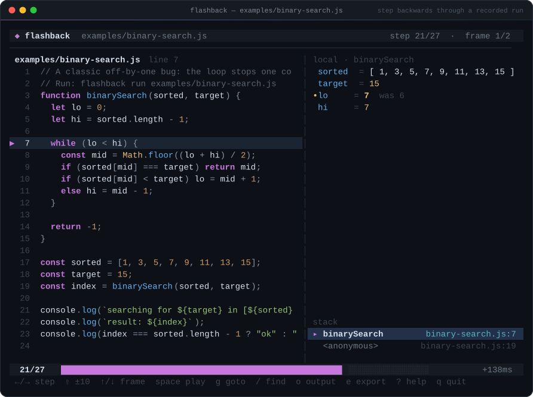
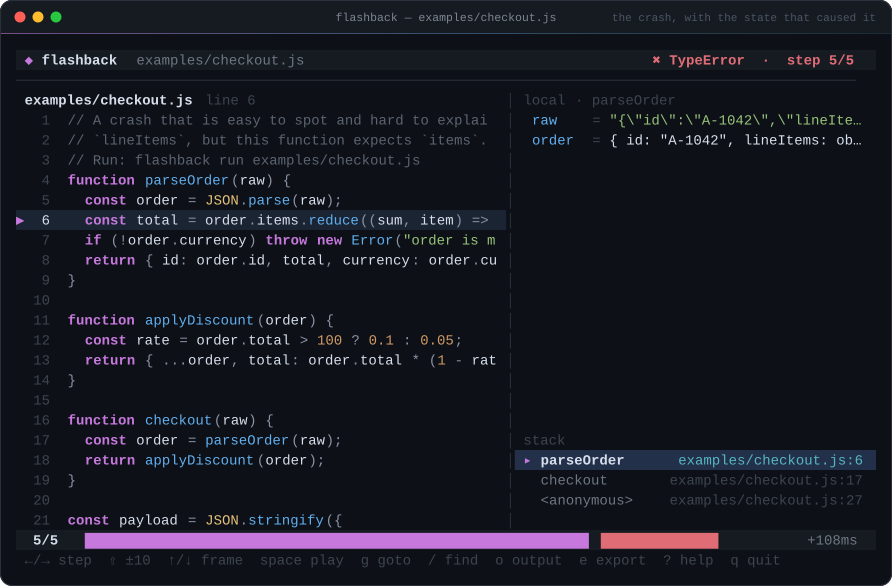
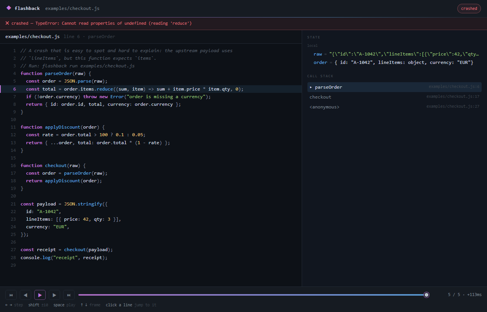

# flashback

**Node.js 的时间旅行调试器。** 录制一次运行，然后**倒着走**——逐行查看每一步的变量、作用域和调用栈。整段执行轨迹可以导出成一个 HTML 文件，直接发给同事。

<p>
  <a href="https://github.com/Coisini-cyber/flashback/actions/workflows/ci.yml"></a>
  
  
  
</p>



`console.log` 是只写的；`node --inspect` 是实时的——等你意识到要看某个值时，现场已经过去了。`flashback` 先把执行过程录下来，之后前后随意移动，也能把「案发现场」原样交给别人。

```
$ flashback run examples/checkout.js

  ✖ crashed: TypeError: Cannot read properties of undefined (reading 'reduce')
  recorded 5 steps · .flashback/2026-10-29T04-52-17-checkout-js.fb.json

$ flashback replay
```



调用栈只告诉你 `order.items` 是 `undefined`；录制告诉你原因——上游字段叫 `lineItems`。不用重跑，不用再加日志。

## 安装

需要 **Node.js 22+**（用到内置 WebSocket 客户端）。运行时**零依赖**。

```bash
git clone https://github.com/Coisini-cyber/flashback
cd flashback
npm link          # 把 flashback 命令装进 PATH
```

不安装也可以直接跑：

```bash
node bin/flashback.js run examples/binary-search.js
```

## 快速开始

```bash
flashback run app.js                 # 录制，然后打开回放 TUI
flashback run app.js --no-replay     # 只录制
flashback replay                     # 打开最近一次录制
flashback export -o bug.html         # 导出可分享的 HTML 播放器
flashback explain                    # 文本摘要：热点行、变量变化、崩溃点
```

录制一个服务端，但跳过启动阶段：

```bash
flashback run server.js --break src/handler.js:42
```

命中断点后开始逐行录制。按 `Ctrl+C` 结束——进程被杀掉之前，轨迹已经保存。

持续观察表达式：

```bash
flashback run worker.js --watch "queue.length" --watch "job.id"
```

## 你能得到什么

- **倒着走。** `←`/`→` 前进一步或后退一步，`Shift` 一次十步。每一步都带局部变量、闭包变量、`this`、watch 值和完整调用栈。
- **崩溃考古。** 未捕获异常会在抛出点（或 V8 回退前的最后一帧）停下来，并保留导致它的准确状态。
- **可分享的轨迹。** `flashback export` 生成单个 HTML 文件：源码、状态面板、时间轴、键盘控制，离线可用，可以直接贴到 issue 或 PR 里。



- **两次运行对比。** `flashback diff before.fb.json after.fb.json` 找出两条执行路径第一次分叉的位置，并打印发生变化的变量；有差异时退出码为 `1`，可以放进 CI。
- **Watch 表达式。** 每一步都求值并写进轨迹，事后能看到一个值如何演变。
- **纯本地。** 不联网、不上报、不调用大模型。录制就是一个 JSON 文件。

## 命令

| 命令 | 作用 |
| --- | --- |
| `flashback run <script> [args...]` | 录制。`--break file:line`、`--max-steps n`、`--watch expr`、`--include dir`、`--all`、`--out file` |
| `flashback replay [recording]` | 打开 TUI 回放（默认最近一次） |
| `flashback export [recording] -o out.html` | 生成自包含 HTML 播放器 |
| `flashback show [recording] --step N` | 以文本打印某一步（`--json` 便于脚本处理） |
| `flashback explain [recording]` | 热点行、变量变化、函数步数、崩溃点 |
| `flashback diff <a> <b>` | 对比两次运行；有差异退出码 `1` |
| `flashback ls` | 列出 `.flashback/` 下的录制 |

给目标脚本传参用 `--`：

```bash
flashback run app.js -- --port 3000 --verbose
```

### 回放快捷键

| 按键 | 动作 |
| --- | --- |
| `←` `→` / `h` `l` | 上一步 / 下一步 |
| `Shift` + 方向键 / `H` `L` | 跳 10 步 |
| `↑` `↓` / `j` `k` | 切换调用帧 |
| `space` | 播放 / 暂停 |
| `g` | 跳到指定步 |
| `/` | 搜索源码并跳到第一个匹配的步骤 |
| `o` | 查看截至当前步的控制台输出 |
| `e` | 在录制文件旁导出 HTML 播放器 |
| `?` | 帮助 |
| `q` | 退出 |

## 原理

`flashback` 用 `--inspect-brk` 在本地回环端口启动目标进程，通过 Node 内置的 `WebSocket` 连接 Chrome DevTools Protocol，然后单步执行。

- Node 内部与 `node_modules` 被 blackbox，只有你的代码会停下来；仍漏进来的内部帧会自动 `stepOut`。
- 每次暂停用 `Runtime.getProperties` 读取作用域，存成有上限的快照：字符串截断、对象只保留前 12 个属性、只抓最上面 3 层帧。所以录制文件小到可以直接发邮件。
- 从入口文件的第一条语句（或 `--break` 指定位置）开始录，不陪 Node 的模块加载器热身。
- 执行回到事件循环且不再暂停，就认为运行结束。未捕获异常同时通过 `Runtime.exceptionThrown` 捕获——有些在原生方法里抛出的错误根本不会触发调试暂停。

录制是纯 JSON：源码、步骤、作用域、watch、stdout。TUI 和 HTML 播放器只是同一份数据的两个视图。

## 限制（录一千万次循环之前先看这里）

- **速度。** 每步几毫秒，`--max-steps` 默认 3000 是有原因的。用 `--break` 只录关心的区间。
- **快照是预览，不是堆转储。** 嵌套对象只展开一层，长字符串会截断；需要精确值就用 `--watch`。
- **异步等待超过空闲窗口（约 1.2 秒）会结束录制。** `await` 续体没问题，结尾挂一个 5 秒的 `setTimeout` 就不行。
- **需要 Node 22+，且在同一台机器上。** 暂不支持远程调试、worker 线程、TypeScript source map。
- 这是调试工具，不是 profiler，也不是生产环境录制器。

## 开发

```bash
npm test          # 单元 + 集成测试（会真的启动 Node 子进程）
npm run demo      # 重新生成 examples/*.fb.json、HTML 播放器和 docs/*.svg
```

测试会录制真实 fixture，校验执行路径、崩溃状态、watch、async 续体和导出的 HTML。

## 许可证

MIT
